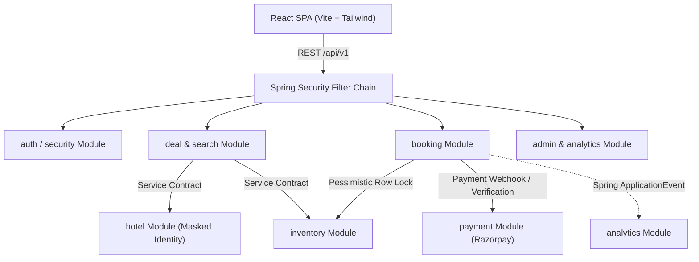

# MysteryStay — Architecture Specification

## 1. Architectural Philosophy: The Modular Monolith

MysteryStay is designed as a **Modular Monolith** rather than distributed microservices.

### Key Justifications
1. **Zero Premature Distributed Complexity**: Avoids distributed network latency, two-phase commits, saga orchestrations, distributed locks across network boundaries, and Kubernetes overhead at this stage.
2. **Strict Encapsulation**: Domain logic and persistence layers are strictly isolated per module. No cross-repository queries are permitted.
3. **Refactor & Extraction Path**: If the Search or Booking modules experience exponential traffic, they can be carved out into independent microservices with minimal refactoring because the bounded contexts are strictly enforced in code.

## 2. Module Boundaries & Contract Enforcement

| Module | Primary Responsibility | Direct Persistence Access | External Interfaces Exposed |
|---|---|---|---|
| **auth** | User authentication, JWT generation, password encryption, token refresh. | `users` | `AuthService` |
| **user** | User profiles, role management, contact verification. | `users` | `UserService` |
| **hotel** | Hotel details, address, verification status, private contact. | `hotels` | `HotelService` |
| **inventory** | Room types, daily room inventory, capacity counters. | `room_types`, `room_inventories` | `InventoryService` |
| **deal** | Identity masking, pricing algorithms, clue generation. | `mystery_deals` | `DealService` |
| **search** | DSA ranking (PriorityQueue), multi-criteria filtering. | In-memory cache / Read-only views | `SearchService` |
| **booking** | State machine, atomic booking creation, concurrency lock. | `bookings` | `BookingService` |
| **payment** | Razorpay sandbox orders, signature check, idempotency. | `payments` | `PaymentService` |
| **analytics** | Occupancy rates, deal velocity, performance metrics. | Read models / Audit logs | `AnalyticsService` |
| **admin** | Hotel onboarding verification, audit oversight. | Cross-cutting admin views | `AdminService` |

## 3. Concurrency & High-Throughput Strategy
- **Pessimistic Locking**: For flash-deal bookings, inventory deduction executes under `@Transactional` with `PESSIMISTIC_WRITE` on `room_inventories` to eliminate the possibility of double-booking under concurrent load.
- **Optimistic Locking**: For hotel manager manual updates, version checks prevent dirty writes.
