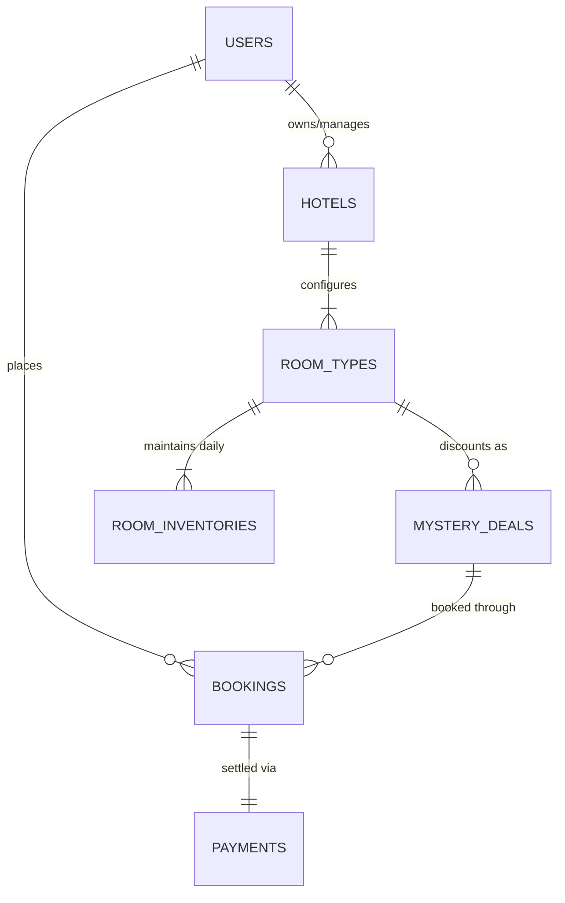

# MysteryStay — Database Architecture & Schema Design

## 1. Design Rules & Guidelines

- **Database Engine**: MySQL 8.4 / 9.x with InnoDB and `utf8mb4_unicode_ci`.
- **Migrations**: 100% Flyway managed (`src/main/resources/db/migration/V{version}__{description}.sql`).
- **JPA DDL Mode**: `spring.jpa.hibernate.ddl-auto=validate`.
- **Monetary Precision**: All monetary values use `DECIMAL(10,2)` and `BigDecimal` in Java.
- **Audit Columns**: Every table includes `created_at` and `updated_at` timestamps.

## 2. Entity-Relationship Overview

## 3. Schema Definitions

### 3.1 `app_metadata` (Baseline V1 Migration)
- `id` (BIGINT, PK, AUTO_INCREMENT)
- `component_name` (VARCHAR(100), UNIQUE)
- `component_version` (VARCHAR(50))
- `status` (VARCHAR(50))
- `created_at` (TIMESTAMP)
- `updated_at` (TIMESTAMP)

### 3.2 Planned Migrations
- `V2__auth_and_user_schema.sql`: `users`, `roles`, `refresh_tokens`.
- `V3__hotel_and_amenity_schema.sql`: `hotels`, `amenities`, `hotel_amenities`.
- `V4__room_inventory_schema.sql`: `room_types`, `room_inventories`.
- `V5__mystery_deals_schema.sql`: `mystery_deals`, `deal_clues`.
- `V6__booking_and_payment_schema.sql`: `bookings`, `payments`, `booking_audit_logs`.
