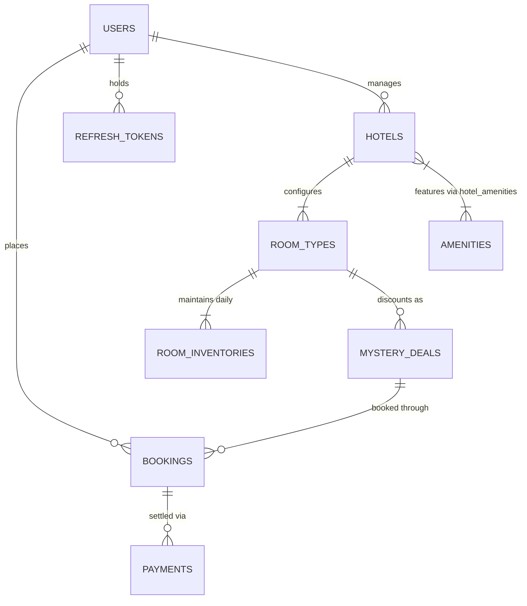

# MysteryStay — Database Architecture & Schema Design

> **Project**: MysteryStay  
> **Tagline**: Discover Hidden Stays. Unlock Better Deals.  
> **Founder & Developer**: Prakash Chakali  
> **Engine**: MySQL 8.4 / 9.x with InnoDB and `utf8mb4_unicode_ci`  
> **Migration Management**: 100% Flyway managed (`src/main/resources/db/migration/`)  
> **DDL Validation**: `spring.jpa.hibernate.ddl-auto=validate`  
> **Monetary Standard**: Strict `DECIMAL(10,2)` columns paired with Java `BigDecimal`

---

## 1. Entity-Relationship Overview

---

## 2. Complete Schema & Migration Ledger (v1 through v7)

### 2.1 `V1__init_schema.sql`: System Metadata
- **`app_metadata`**:
  - `id` (BIGINT, PK, AUTO_INCREMENT)
  - `component_name` (VARCHAR(100), UNIQUE, NOT NULL)
  - `component_version` (VARCHAR(50), NOT NULL)
  - `status` (VARCHAR(50), NOT NULL)
  - `created_at`, `updated_at` (TIMESTAMP)

### 2.2 `V2__auth_and_user_schema.sql`: Identity & Session
- **`users`**:
  - `id` (BIGINT, PK, AUTO_INCREMENT)
  - `email` (VARCHAR(150), UNIQUE, NOT NULL, INDEX `idx_users_email`)
  - `password_hash` (VARCHAR(255), NOT NULL, BCrypt strength 12)
  - `full_name` (VARCHAR(100), NOT NULL)
  - `phone` (VARCHAR(20))
  - `role` (VARCHAR(30), NOT NULL) — `ROLE_CUSTOMER`, `ROLE_HOTEL_MANAGER`, `ROLE_ADMIN`
  - `enabled` (BOOLEAN, DEFAULT TRUE)
  - `created_at`, `updated_at` (TIMESTAMP)
- **`refresh_tokens`**:
  - `id` (BIGINT, PK, AUTO_INCREMENT)
  - `user_id` (BIGINT, FK `users(id)`, ON DELETE CASCADE, INDEX `idx_refresh_tokens_user`)
  - `token` (VARCHAR(255), UNIQUE, NOT NULL, INDEX `idx_refresh_tokens_token`)
  - `expires_at` (TIMESTAMP, NOT NULL)
  - `revoked` (BOOLEAN, DEFAULT FALSE)
  - `created_at`, `updated_at` (TIMESTAMP)

### 2.3 `V3__hotel_and_amenity_schema.sql`: Hotel Management & Amenities
- **`amenities`**:
  - `id` (BIGINT, PK, AUTO_INCREMENT)
  - `name` (VARCHAR(100), UNIQUE, NOT NULL)
  - `category` (VARCHAR(50), NOT NULL) — `WELLNESS`, `DINING`, `ROOM`, `FACILITY`
  - `mystery_clue_tag` (VARCHAR(100), NOT NULL)
  - `created_at`, `updated_at` (TIMESTAMP)
- **`hotels`**:
  - `id` (BIGINT, PK, AUTO_INCREMENT)
  - `manager_id` (BIGINT, FK `users(id)`, NOT NULL, INDEX `idx_hotels_manager`)
  - `name` (VARCHAR(150), NOT NULL)
  - `brand_chain` (VARCHAR(100))
  - `star_rating` (INT, NOT NULL, CHECK 1-5)
  - `address` (VARCHAR(255), NOT NULL)
  - `city` (VARCHAR(100), NOT NULL, INDEX `idx_hotels_city`)
  - `zone_area` (VARCHAR(100), NOT NULL, INDEX `idx_hotels_zone`)
  - `postal_code` (VARCHAR(20), NOT NULL)
  - `latitude`, `longitude` (DECIMAL(10,7))
  - `phone`, `email` (VARCHAR(100), NOT NULL)
  - `verified` (BOOLEAN, DEFAULT FALSE, INDEX `idx_hotels_verified`)
  - `created_at`, `updated_at` (TIMESTAMP)
- **`hotel_amenities`**:
  - `hotel_id` (BIGINT, FK `hotels(id)`, ON DELETE CASCADE)
  - `amenity_id` (BIGINT, FK `amenities(id)`, ON DELETE CASCADE)
  - PRIMARY KEY (`hotel_id`, `amenity_id`)

### 2.4 `V4__room_inventory_schema.sql`: Inventory Ledger & Calendar
- **`room_types`**:
  - `id` (BIGINT, PK, AUTO_INCREMENT)
  - `hotel_id` (BIGINT, FK `hotels(id)`, ON DELETE CASCADE, INDEX `idx_room_types_hotel`)
  - `name` (VARCHAR(100), NOT NULL)
  - `category` (VARCHAR(50), NOT NULL) — `STANDARD_ROOM`, `DELUXE_ROOM`, `EXECUTIVE_SUITE`, `PRESIDENTIAL_SUITE`, `VILLA`, `PENTHOUSE`
  - `description` (TEXT)
  - `max_adults`, `max_children` (INT, NOT NULL)
  - `base_price` (DECIMAL(10,2), NOT NULL)
  - `created_at`, `updated_at` (TIMESTAMP)
- **`room_inventories`**:
  - `id` (BIGINT, PK, AUTO_INCREMENT)
  - `room_type_id` (BIGINT, FK `room_types(id)`, ON DELETE CASCADE, INDEX `idx_room_inv_type_date`)
  - `inventory_date` (DATE, NOT NULL, INDEX `idx_room_inv_date`)
  - `total_rooms` (INT, NOT NULL)
  - `booked_rooms` (INT, NOT NULL DEFAULT 0)
  - `available_rooms` (INT, NOT NULL, CHECK `available_rooms >= 0`)
  - `nightly_rate` (DECIMAL(10,2), NOT NULL)
  - `version` (BIGINT, DEFAULT 0)
  - `created_at`, `updated_at` (TIMESTAMP)
  - UNIQUE KEY `uk_room_type_date` (`room_type_id`, `inventory_date`)

### 2.5 `V5__mystery_deals_schema.sql`: Confidential Mystery Deals
- **`mystery_deals`**:
  - `id` (BIGINT, PK, AUTO_INCREMENT)
  - `room_type_id` (BIGINT, FK `room_types(id)`, ON DELETE CASCADE, INDEX `idx_deals_room_type`)
  - `mystery_title` (VARCHAR(200), NOT NULL)
  - `description_clues` (TEXT, NOT NULL)
  - `discount_percent` (INT, NOT NULL, CHECK `discount_percent >= 20 AND discount_percent <= 70`)
  - `mystery_price` (DECIMAL(10,2), NOT NULL)
  - `start_date`, `end_date` (DATE, NOT NULL, INDEX `idx_deals_dates`)
  - `status` (VARCHAR(30), NOT NULL DEFAULT 'ACTIVE', INDEX `idx_deals_status`)
  - `created_at`, `updated_at` (TIMESTAMP)

### 2.6 `V6__booking_schema.sql`: Concurrency-Guarded Reservations
- **`bookings`**:
  - `id` (BIGINT, PK, AUTO_INCREMENT)
  - `booking_reference` (VARCHAR(50), UNIQUE, NOT NULL, INDEX `idx_bookings_ref`)
  - `user_id` (BIGINT, FK `users(id)`, NOT NULL, INDEX `idx_bookings_user`)
  - `hotel_id` (BIGINT, FK `hotels(id)`, NOT NULL)
  - `room_type_id` (BIGINT, FK `room_types(id)`, NOT NULL)
  - `mystery_deal_id` (BIGINT, FK `mystery_deals(id)`)
  - `check_in_date`, `check_out_date` (DATE, NOT NULL)
  - `room_count`, `adult_count`, `child_count` (INT, NOT NULL)
  - `guest_name`, `guest_email`, `guest_phone` (VARCHAR, NOT NULL)
  - `nightly_rate`, `total_amount` (DECIMAL(10,2), NOT NULL)
  - `status` (VARCHAR(30), NOT NULL, INDEX `idx_bookings_status`) — `PENDING_PAYMENT`, `CONFIRMED`, `CANCELLED`, `EXPIRED`
  - `identity_revealed` (BOOLEAN, NOT NULL DEFAULT FALSE)
  - `expires_at` (TIMESTAMP, NOT NULL, INDEX `idx_bookings_expires_at`)
  - `special_requests` (VARCHAR(500))
  - `created_at`, `updated_at` (TIMESTAMP)

### 2.7 `V7__payment_schema.sql`: Razorpay Sandbox Transactions
- **`payments`**:
  - `id` (BIGINT, PK, AUTO_INCREMENT)
  - `payment_reference` (VARCHAR(64), UNIQUE, NOT NULL)
  - `booking_id` (BIGINT, FK `bookings(id)`, ON DELETE CASCADE, INDEX `idx_payments_booking_id`)
  - `razorpay_order_id` (VARCHAR(100), UNIQUE, NOT NULL, INDEX `idx_payments_order_id`)
  - `razorpay_payment_id` (VARCHAR(100))
  - `razorpay_signature` (VARCHAR(255))
  - `amount` (DECIMAL(10,2), NOT NULL)
  - `currency` (VARCHAR(10), NOT NULL DEFAULT 'USD')
  - `status` (VARCHAR(30), NOT NULL, INDEX `idx_payments_status`) — `CREATED`, `SUCCESS`, `FAILED`, `REFUNDED`
  - `error_code`, `error_description` (VARCHAR)
  - `created_at`, `updated_at` (TIMESTAMP)
